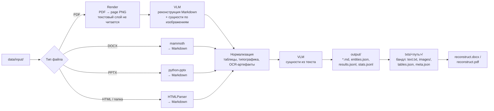

# Offline PDF Batch Pipeline

Локальный, air-gapped пайплайн пакетной обработки документов: **PDF/DOCX/PPTX/HTML → VLM → Markdown → сущности**.
Сеть отключена (`internal: true`), все модели и веса — локальные.

## Поток данных

## Компоненты

| Компонент | Роль |
|---|---|
| `worker` (`idp`) | Оркестратор: обход input, конкурентная обработка файлов, запись артефактов |
| `vllm-vl-0/1` | Два инстанса vLLM с одной VL-моделью (GPU0/GPU1), round-robin через `IDP_VL_ENDPOINTS` |
| `sglang` (оверлей) | Альтернативный бэкенд инференса вместо vLLM |

Артефакты пишутся только на диск: ни PostgreSQL, ни MinIO, ни брокера очередей нет.
Очередь — `asyncio` + семафор `IDP_VL_CONCURRENCY` внутри одного процесса.

## Ключевые свойства

- **PDF**: страницы рендерятся в PNG (`PyMuPDF`), текстовый слой не читается никогда.
- **Идемпотентность**: файл пропускается, если он есть в `results.jsonl` со статусом `ok`/`skip`; `--force` обрабатывает заново.
- **Выходные пути повторяют структуру input** — файлы с одинаковым именем из разных подпапок не конфликтуют.
- **Сущности**: из текста (чанки по 6000 символов, поле `page` вычисляется по маркерам `<!-- page N -->`) и с изображений (чанки по `IDP_VL_MAX_IMAGES` страниц), затем дедупликация и нормализация.
- **Схема сущностей**: рабочая копия в `output/entity_schema.json`; новые типы дописываются туда, пакетная копия остаётся read-only шаблоном.
- **Бандлы**: `text.txt` ссылается на вырезанные по bbox области (`figure_*`, `handwritten_*`), из которых `reconstructor` собирает настоящие DOCX/PDF.

## Ограничения и флаги

| Параметр | Значение |
|---|---|
| `IDP_VL_CONCURRENCY` | одновременных запросов к VLM (по умолчанию 12) |
| `IDP_VL_MAX_IMAGES` | страниц в одном запросе (по умолчанию 2) |
| `IDP_VL_TIMEOUT_SECONDS` | таймаут запроса, 3 попытки с backoff 1s/2s/4s |
| `IDP_MIN_ENTITY_CONFIDENCE` | порог уверенности сущности (по умолчанию 0.3) |
| `IDP_RECONSTRUCT_FORMATS` | `docx,pdf` / пусто |
| `IDP_ENTITY_SCHEMA_PATH` | путь рабочей схемы сущностей |
| `IDP_LOG_LEVEL` | уровень логов (`DEBUG` — диагностика VLM и рендера) |
