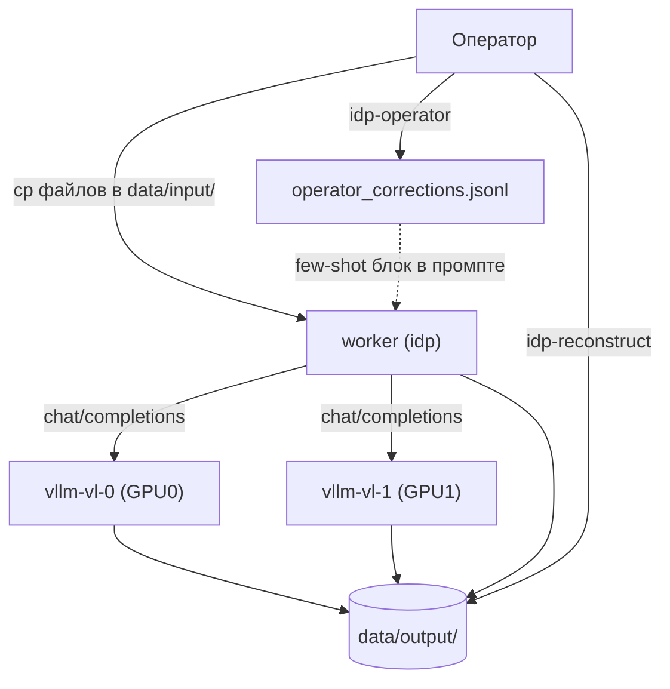

# Architecture: Offline Document Pipeline

## Scope

Один Docker Compose стек, работающий без интернета. Вход — каталог с PDF/DOCX/PPTX/HTML,
выход — Markdown, сущности и бандлы для восстановления документов. Внешних сервисов нет:
никакой базы данных, объектного хранилища, брокера очередей, OCR-движка и HITL-портала.
Весы моделей монтируются с хоста; скачивание чего-либо в runtime запрещено.

## System Context

Сеть Compose `internal: true`: worker видит только сервисы стека, наружу — ничего.

## Worker

Один процесс, `asyncio`. Обход `input_root` рекурсивно (`rglob`); папки с `*.html`
обрабатываются как один документ. Для каждого файла:

1. **Конвертация** — PDF рендерится в PNG (`src/idp/renderer.py`, пул потоков, документ
   открывается per-thread), DOCX/PPTX/HTML конвертируются нативно. Текстовый слой PDF
   не читается никогда.
2. **VLM** — `src/idp/vlm_client.py`: реконструкция Markdown по чанкам страниц
   (`IDP_VL_MAX_IMAGES`), затем извлечение сущностей из чистого текста и отдельно
   с изображений. Общий `httpx.AsyncClient` на процесс, round-robin по эндпоинтам,
   3 попытки с backoff на сетевые ошибки и 429/5xx.
3. **Постобработка** — нормализация таблиц, типографики, чистка OCR-артефактов,
   снятие bbox-аннотаций; абзацы и заголовки выделяются в `entities`/`paragraphs`.
4. **Сущности** — `page` для текстовых чанков вычисляется по маркерам `<!-- page N -->`,
   для визуальных — по позиции чанка; далее дедупликация, нормализация и порог
   уверенности `IDP_MIN_ENTITY_CONFIDENCE`.
5. **Артефакты** — `<stem>.md` (только `--artifacts`), бандл `txts/`, рендеры `rendered/`,
   `reconstruct.docx/pdf` из бандла. Тяжёлые операции (рендер, экспорт, сборка)
   выполняются в `asyncio.to_thread`, чтобы не блокировать event loop.

Результаты: `results.jsonl` (append per file) + `results_readable.json` (rewrite раз в
прогон), `entities.json` (flush раз в прогон и каждые 50 файлов), `stats.jsonl`
(append per file). Все пути вывода повторяют структуру input.

## Inference backends

- `vllm-vl-0`, `vllm-vl-1` — два инстанса vLLM с одной VL-моделью, по одному на GPU;
  worker балансирует запросы round-robin (`IDP_VL_ENDPOINTS`).
- `infra/compose/sglang.yml` — оверлей поверх `local.yml`, переключает те же сервисы
  на SGLang (порты и имена не меняются).

Параметры инференса (квантизация, длина контекста, KV-cache) задаются в compose,
не в Python-коде.

## Schema и фидбек

- Схема сущностей: `src/idp/entity_schema.json` — read-only шаблон; рабочая копия
  (`IDP_ENTITY_SCHEMA_PATH`, по умолчанию `<output_root>/entity_schema.json`)
  создаётся/дополняется автоматически. Запись не может уронить прогон: при отказе
  файловой системы пишется warning.
- `idp-operator` — терминальный review страниц; корректировки оператора попадают в
  `operator_corrections.jsonl` и подмешиваются few-shot блоком в system-промпт
  (`FeedbackCache`, инвалидация по mtime+size файла).
- `idp-finetune-dataset` — конвертирует коррекции в `finetune_data.jsonl`; системный
  промпт в датасете всегда продакшн-версия.

## Логирование

Все модули используют `logging`; уровень — `IDP_LOG_LEVEL` (по умолчанию `INFO`).
Прогресс-бар tqdm идёт в stdout, диагностика — в stderr.
